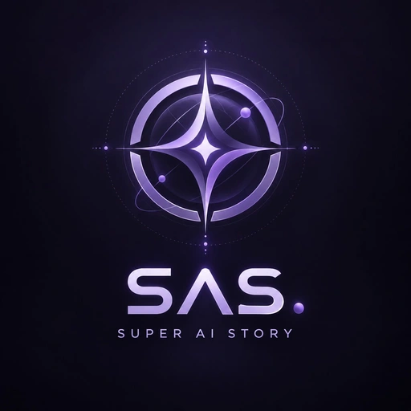

<div align="center">



# SAS · Super AI Story

**Персонажи, фанфики и совместные приключения с языковыми моделями.**

[](https://github.com/Padparaja-Ge/Super-AI-Story/releases/latest)
[](LICENSE)


[Скачать](https://github.com/Padparaja-Ge/Super-AI-Story/releases/latest) · [Руководство](docs/USER-GUIDE.md) · [Запуск и сборка](docs/BUILDING.md) · [Расширения](docs/EXTENSIONS-API.md) · [Сообщить о проблеме](https://github.com/Padparaja-Ge/Super-AI-Story/issues)

</div>

SAS — локальная русскоязычная студия для ролевых историй. Она объединяет карточки персонажей, персоны игроков, знания о мире, память, иллюстрации и озвучку. Можно использовать собственную GGUF-модель, подключить совместимый API или играть с друзьями через веб-интерфейс.

**В этом репозитории находятся полные исходники приложения:** React-интерфейс в `src/`, Node.js-сервер в `server/`, общие модели данных в `shared/`, оболочка Electron в `electron/`, тесты и сценарии сборки. Готовые программы распространяются в [Releases](https://github.com/Padparaja-Ge/Super-AI-Story/releases).

## Возможности

| Режим | Назначение |
| --- | --- |
| **Ролевая история** | Диалоги с персонажами, собственная персона, сцена, лор и память отдельной истории. |
| **Фанфик** | Произведения, сезоны и серии; авторские настройки, герои, канон, утверждение текста и память произведения. |
| **Мультиплеер RP** | Общая история с друзьями, лобби, роли участников, инструменты хоста и сохранение партии. |
| **D&D / своя НРИ** | Ведущий, сюжетные книги, книги правил, тактическая карта, инициатива, инвентарь и расчёт действий игровым движком. |

- **Модели:** встроенная интеграция llama.cpp, GGUF, CPU/CUDA/Vulkan, OpenAI-совместимые API, настройки Dense и MoE, отдельная модель embeddings.
- **Контекст:** карточки и персоны, привязанные лорбуки, состояние сцены, хронологические сводки, опциональный векторный поиск. Контексты историй, фанфиков и комнат разделены.
- **Мастер материалов:** создание и редактирование персонажей, персон и Story books, ручные правки, импорт и экспорт.
- **Иллюстрации:** ComfyUI со своими workflow и checkpoint; отдельные настройки сцен и карт, направляющие глубины и нормалей.
- **Звук:** Silero RU/EN, дополнительные движки озвучки и голосовые профили; плейлист хоста и голосовая связь в комнатах.
- **Работа с текстом:** перевод через backend, корректура и редактирование перед отправкой.
- **Расширения:** собственные страницы, панели, команды, оформление, серверные функции и hooks контекста через SAS API 2.

В D&D/НРИ модель ведёт повествование и выбирает действия NPC; допустимость действий, броски, урон и ресурсы рассчитывает серверный движок. Качество текста и воспоминаний зависит от модели и настроек её контекста.

## Готовое приложение

Для готового Windows-пакета Node.js и сборка не нужны.

1. Откройте [последний выпуск](https://github.com/Padparaja-Ge/Super-AI-Story/releases/latest).
2. Скачайте **SAS-Windows-0.9.5.zip**, распакуйте в отдельную папку, например `D:\SAS`.
3. Запустите **SAS.exe**. Папки `app/` и `engines/` должны оставаться рядом с ним.
4. В **Настройки → Модели и API** выберите свою GGUF-модель или подключение к API.

Небольшой **SAS-Start-0.9.5.zip** позволяет установить тот же пакет через `Start-SAS.cmd`. Полный архив подходит для установки без сети. Для локальной работы заранее установите нужные модели; облачные API, переводчики и загрузки требуют интернета.

В готовой поставке `Start-SAS-Web.cmd` запускает веб-сервер и открывает браузер. Enter закрывает консоль, оставляя сервер в фоне; `Stop-SAS-Web.cmd` завершает его работу. `Repair-SAS.cmd` проверяет и восстанавливает файлы.

## Запуск из исходников

Нужны **Node.js 22+**, npm и Git. Для первого `npm ci` требуется сеть. Python и локальная LLM не обязательны для интерфейса и работы через внешний API.

```sh
git clone https://github.com/Padparaja-Ge/Super-AI-Story.git
cd Super-AI-Story
npm ci
npm run build
```

### Окно Electron

```sh
npm run desktop
```

### Полный веб-интерфейс

```sh
npm run web
```

По умолчанию: **http://127.0.0.1:3212**. Остановка исходного веб-сервера — **Ctrl+C**. В Windows также доступны корневые `Start-SAS.cmd` и `Start-SAS-Web.cmd`: это команды запуска **исходников**, которым нужен Node.js.

### Разработка интерфейса

```sh
npm run dev
```

Vite: **http://127.0.0.1:5173**, backend: `127.0.0.1:3210`. Перезапуск интерфейса автоматический. [Подробности, переменные окружения и диагностика](docs/BUILDING.md).

## Сборка Electron и релиза

Приложение без включённых моделей и движков:

```sh
npm run package:app
```

Для полного Windows-пакета сначала подготовьте локальные компоненты. Можно взять их из проверенного готового ZIP:

```sh
npm run prepare:runtime -- --archive "D:\Downloads\SAS-Windows-0.9.5.zip"
npm run package:win
```

Результат: `release/0.9.5/`. Сценарии не загружают модели автоматически. Подготовка без готового ZIP, состав пакета и команды упаковки веб-версии описаны в [BUILDING.md](docs/BUILDING.md).

## Структура проекта

```text
src/             React-интерфейс, стили и клиентские инструменты
server/          API, контекст, память, комнаты, интеграции и игровой движок
shared/          Общие типы, правила, настройки и примеры данных
electron/        Настольная оболочка, права, запуск и завершение
public/, assets/ Статические ресурсы и оформление
scripts/         Запуск, подготовка компонентов, сборка и упаковка
distribution/    Исходники запускателя и файлов готовой поставки
examples/        Примеры расширений, workflow и импортируемых данных
tests/           Автоматические тесты
docs/            Руководства пользователя и разработчика
release/         Локальные результаты сборки, не хранятся в Git
```

`app.asar` в готовой программе — пакет файлов Electron для исполнения. Редактируемые TS/TSX-исходники, настройки сборки и тесты находятся в этом репозитории.

## Плагины и моды

Расширения SAS устанавливаются из ZIP/JSON и включаются пользователем. Для них не нужна пересборка Electron. Можно добавлять страницы и панели, команды, CSS, отдельное хранилище, серверные маршруты и инструкции для выбранных режимов.

- [Руководство SAS API 2: примеры, методы и FAQ](docs/EXTENSIONS-API.md).
- [Рабочий пример «Заметки кампании»](examples/sas-extensions/campaign-notes).
- Упаковка: `npm run package:extension -- ./my-extension ./my-extension.zip`.
- [Правила участия в разработке](CONTRIBUTING.md).

Расширение — доверенный исполняемый код: frontend получает доступ к странице, backend — права процесса Node.js. Проверяйте исходники перед включением. Безопасный режим: `SAS_DISABLE_EXTENSIONS=1` или `Start-SAS-Safe.cmd`.

Форматы карточек, лорбуков, пресетов и Regex SillyTavern импортируются выборочно. Его JavaScript API не реализован полностью; плагины требуют адаптации на SAS API.

## Данные и сеть

В Windows основной каталог данных — `%APPDATA%\Super AI Story\data`; режим разработки использует локальную `data/`. Собственный путь задаётся через `SAS_DATA_DIR`. Не публикуйте каталог данных, `.env`, ключи и личные истории.

`web-server.json` содержит адрес, порт, ключ и режим IP-списка. По умолчанию доступен только localhost. Для LAN/VPN настройте адрес прослушивания, разрешённые IP/подсети и ключ. Доступ между разными сетями зависит от маршрутизации и брандмауэра; встроенный сервер не заменяет VPN. [Настройка сети](docs/MULTIPLAYER-NETWORK.md).

Локальные запросы остаются на вашем компьютере; при использовании внешних API и переводчиков данные отправляются выбранному сервису.

## Документация

| Руководство | Содержание |
| --- | --- |
| [Пользование SAS](docs/USER-GUIDE.md) | Первый запуск, модели, истории, память и комнаты |
| [Запуск и сборка](docs/BUILDING.md) | Требования, команды, релизы и диагностика |
| [Фанфик](docs/FANFIC-GUIDE.md) | Произведения, серии, канон и память |
| [Расширения](docs/EXTENSIONS-API.md) | SDK, примеры, упаковка, серверные hooks |
| [Автосохранение](docs/AUTOSAVE.md) | Ручное сохранение, интервалы и резервные копии |
| [Мультиплеер](docs/MULTIPLAYER.md) | Подключение, роли и возможности комнаты |
| [Звук в комнатах](docs/MULTIPLAYER-MEDIA.md) | Музыка, микрофон и управление голосом |

Проверки проекта: `npm test` и `npm run build`. Для отчёта об ошибке укажите ОС, версию SAS, режим запуска, модель/API и шаги воспроизведения. Не прикладывайте секреты и чужие персональные данные.

## Авторы и лицензии

© 2026 **Padparaja**. Разработчики: [**Padparaja-Ge**](https://github.com/Padparaja-Ge) и [**Wenzeslaus-first**](https://github.com/Wenzeslaus-first).

Оригинальный код и документация SAS распространяются по [Apache-2.0](LICENSE). Авторство сохраняется; условия вкладов и использования бренда описаны в [COPYRIGHT.md](COPYRIGHT.md) и [NOTICE](NOTICE).

Сторонние компоненты, отдельные утилиты и модели сохраняют свои лицензии. В частности, модель Silero имеет условия **CC BY-NC-SA 4.0**; разрешения Apache на код SAS не отменяют ограничений моделей. См. [THIRD-PARTY.md](THIRD-PARTY.md).
